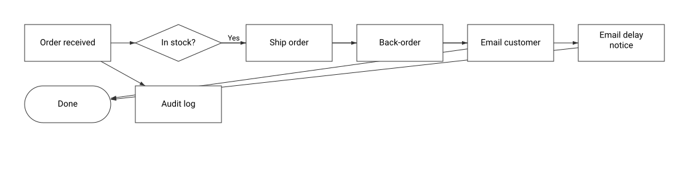
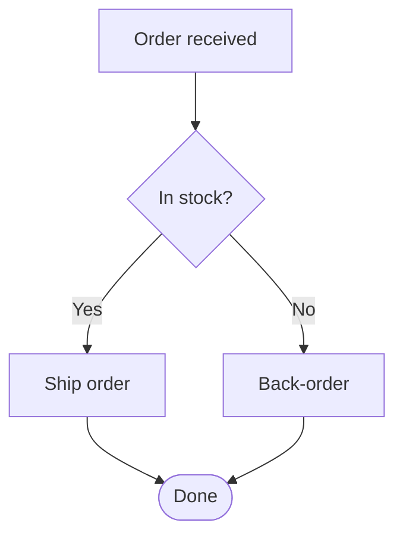

# Sample Order Flow

| | |
|---|---|
| Diagram type | Generic Flowchart |
| Canvas version | 2 |
| Standard | Still Active 1792671292012 (version 78) |
| Open in Canvas | [Sample Order Flow](http://localhost:5173/?diagramId=bd97bbce-12f5-44eb-aaba-f8b7f1c9fdca) |

Mermaid source

_Generated by Canvas. Edit this diagram in Canvas, not here: changes made in this repository are not copied back._
