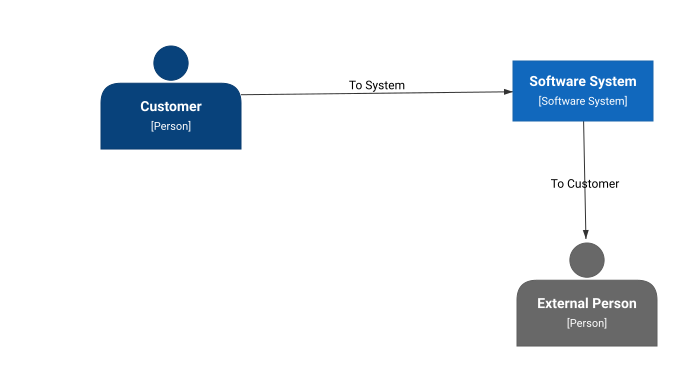
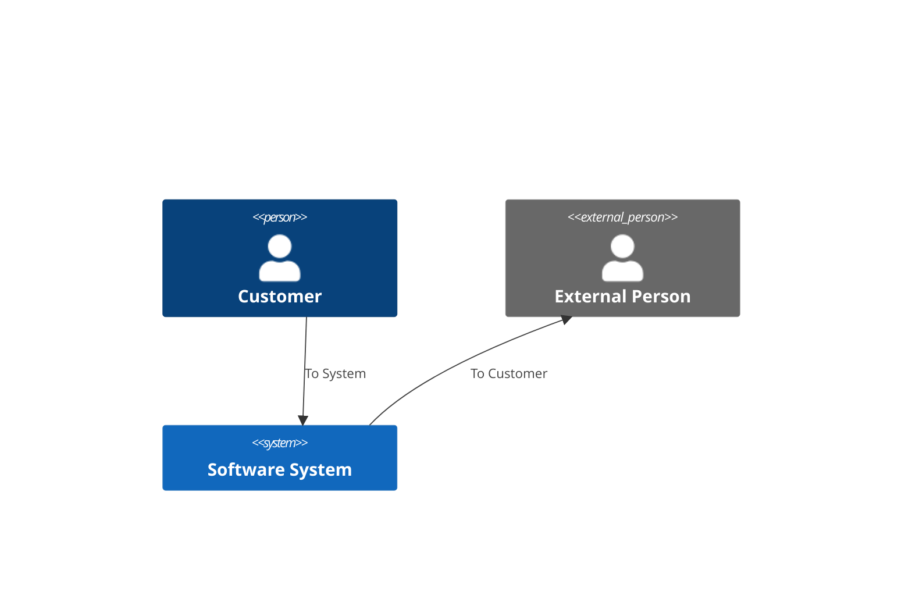

# C4 Test

| | |
|---|---|
| Diagram type | C4 Container |
| Canvas version | 4 |
| Standard | C4 Container \(starter\) (version 1) |
| Open in Canvas | [C4 Test](https://canvaswebsgsjwpx53dvpy.z19.web.core.windows.net/?diagramId=d7288197-d3af-4600-b52d-7b5aa6baa494) |

A C4 diagram

Mermaid source

_Generated by Canvas. Edit this diagram in Canvas, not here: changes made in this repository are not copied back._
