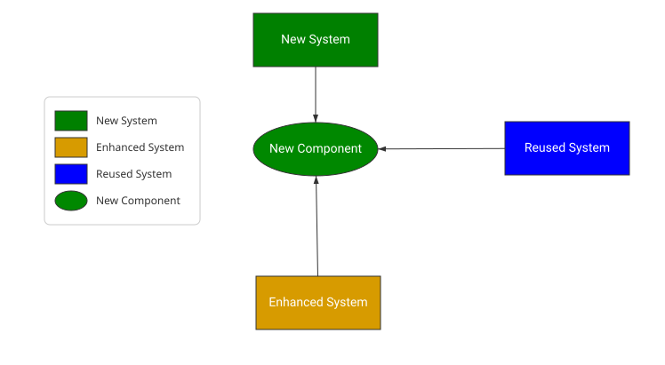
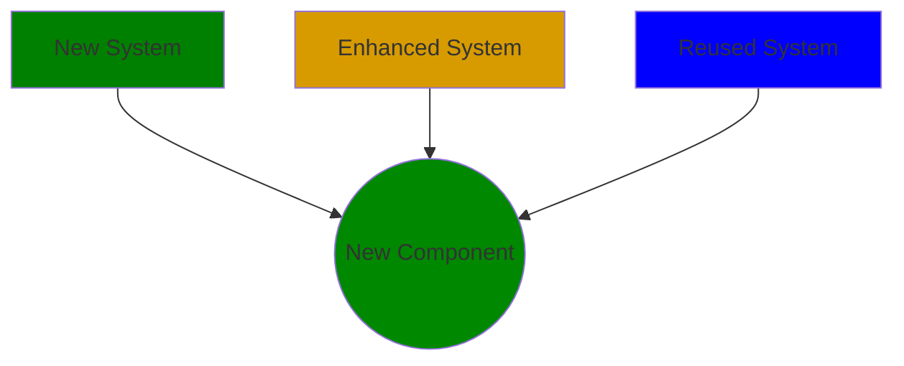

# Product Context

| | |
|---|---|
| Diagram type | Product Context Diagram |
| Canvas version | 4 |
| Standard | Product Context Diagram Standard (version 7) |
| Open in Canvas | [Product Context](https://canvaswebsgsjwpx53dvpy.z19.web.core.windows.net/?diagramId=95a2951d-61b5-4556-baa9-497e92654941) |

Mermaid source

_Generated by Canvas. Edit this diagram in Canvas, not here: changes made in this repository are not copied back._
