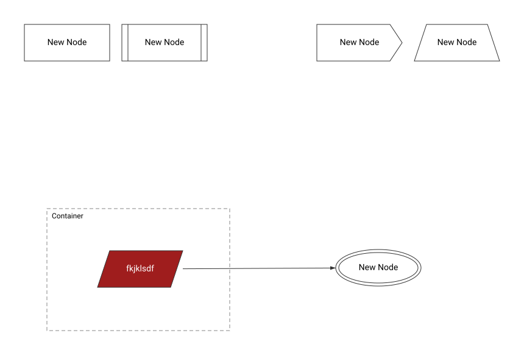
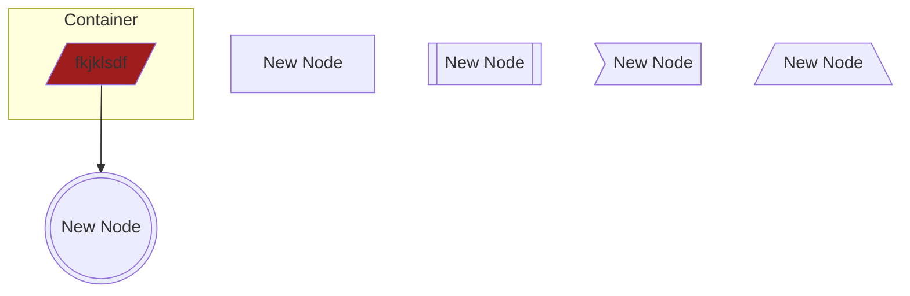

# Ttitle

_Layout as drawn in Canvas._

| | |
|---|---|
| Diagram type | Generic Flowchart |
| Canvas version | 3 |
| Standard | Generic Flowchart \(starter\) (version 1) |
| Open in Canvas | [Ttitle](https://canvas-api.ashyplant-d37418e1.centralus.azurecontainerapps.io/?diagramId=823cd1a6-57ce-40b6-95ad-91d98ab3758b) |

Mermaid source

GitHub arranges this view automatically, so positions differ from Canvas. Colours are kept where Mermaid supports them.

_Generated by Canvas. Edit this diagram in Canvas, not here: changes made in this repository are not copied back._
